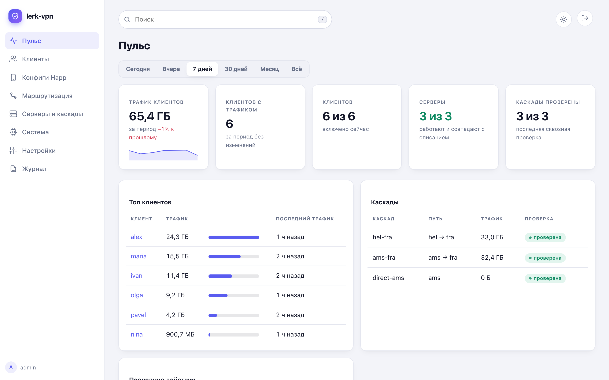
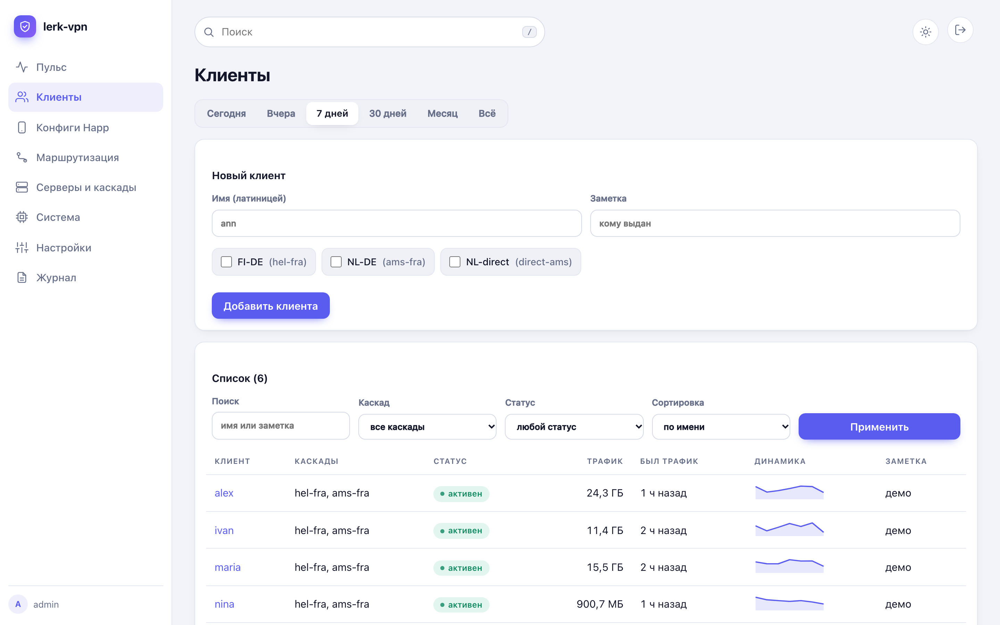
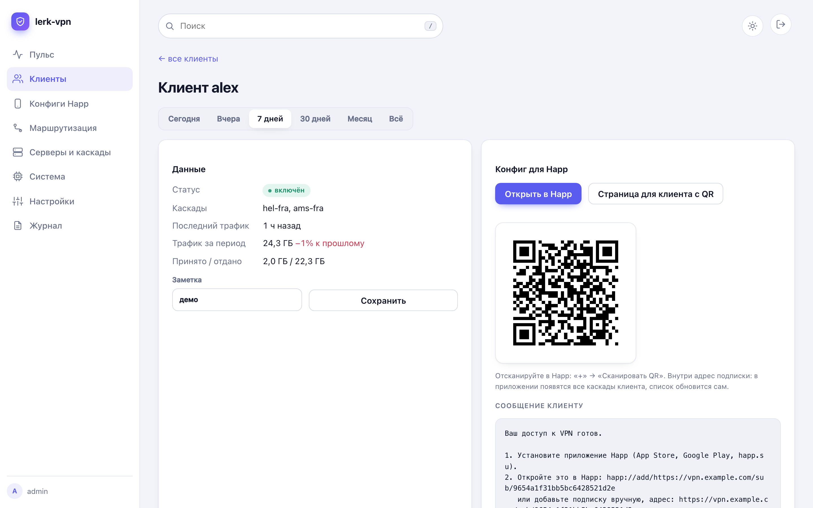
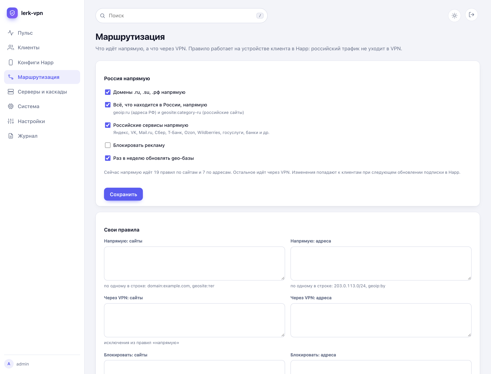
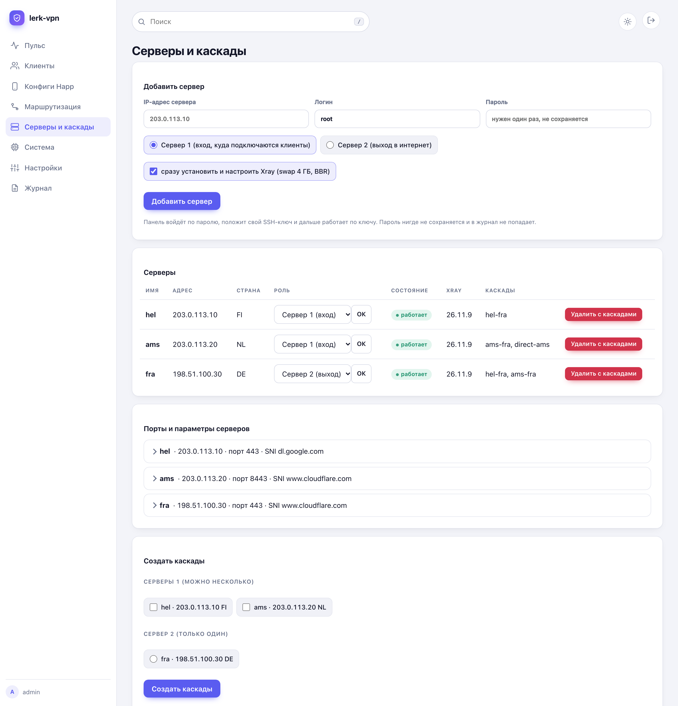
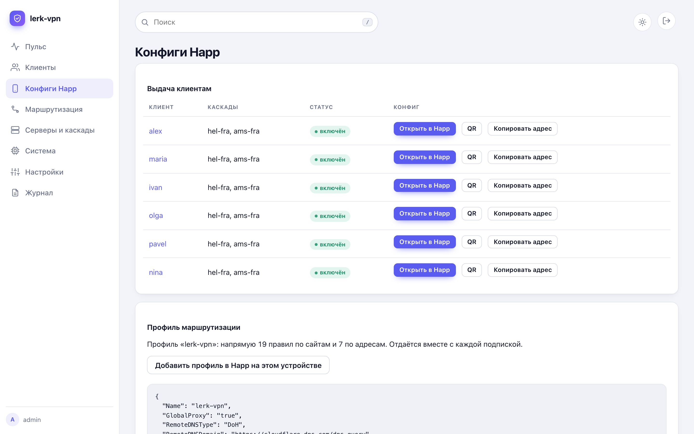
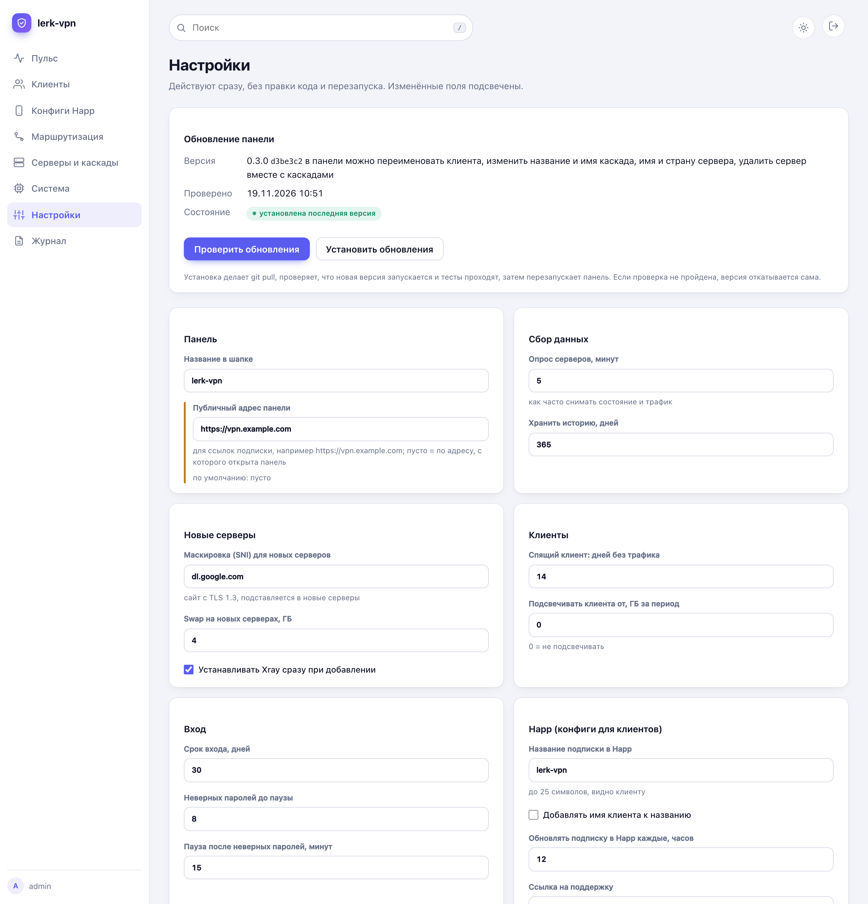
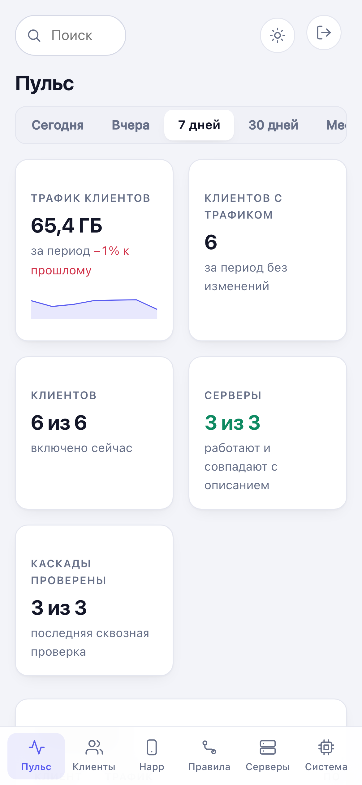
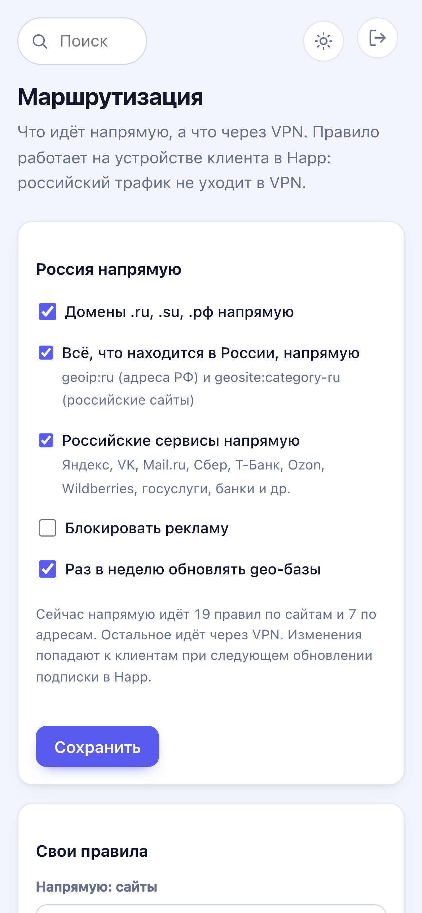
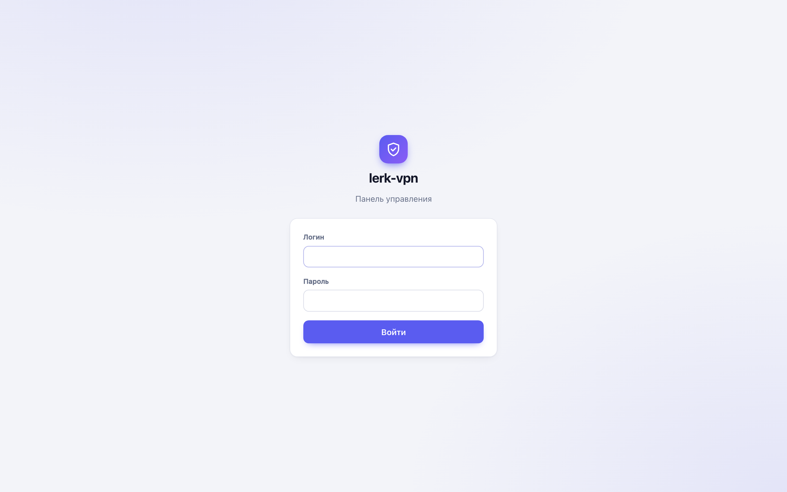

<div align="center">

# lerk-vpn

**Каскадные VPN на Xray (VLESS + Reality) с веб-панелью, конфигами для Happ и российским трафиком напрямую.**

Ставится одной командой. Серверы добавляются по IP, логину и паролю. Клиенты получают подписку по ссылке или QR-коду.

[](https://github.com/LerkOFF/lerk-vpn/releases)
[](LICENSE)




</div>

## Что это

Сервис для тех, кто продаёт или держит для себя VPN из нескольких серверов. Вы выбираете серверы 1 (куда подключаются клиенты) и сервер 2 (выход в интернет), панель сама ставит Xray, настраивает цепочку, выпускает ключи и отдаёт каждому клиенту готовую подписку для приложения Happ.

```
клиент  ->  сервер 1 (вход)  ->  сервер 2 (выход)  ->  интернет
```

Можно и без каскада: клиент подключается к одному серверу и выходит с его адреса (прямой доступ).

## Возможности

| Раздел | Что умеет |
| --- | --- |
| Серверы | добавление по IP, логину и паролю: панель кладёт свой SSH-ключ, ставит Xray, swap и BBR; роли «сервер 1» и «сервер 2»; переименование, удаление |
| Каскады | несколько серверов 1 и один сервер 2 в один клик; прямой доступ без каскада; сквозная проверка, с какого IP идёт выход |
| Параметры сервера | порт Xray и SSH, SNI маскировки Reality, fingerprint, flow, мультиплексирование mux, swap, блокировка торрентов, файрвол |
| Клиенты | создание, отключение, смена ключей, заметки, переименование без смены ссылки, привязка к нескольким каскадам |
| Happ | ссылка подписки, deeplink, QR-код, готовое сообщение клиенту, заголовки профиля, объявление, ссылка на поддержку |
| Маршрутизация | российский трафик напрямую: `.ru`, `.su`, `.рф`, `geoip:ru`, `geosite:category-ru`, российские сервисы; свои правила, каталог тегов, проверка домена и IP |
| Статистика | трафик по клиентам и каскадам, периоды по Москве со сравнением с прошлым, состояние серверов |
| Обновление | кнопки «Проверить» и «Установить»: git pull, проверка запуска и тестов, автоматический откат |
| Безопасность | хеш пароля scrypt, лимит попыток, CSRF, строгий CSP, журнал всех действий |

## Скриншоты

<table>
<tr>
<td width="50%"><br><sub>Клиенты: список, фильтры, динамика</sub></td>
<td width="50%"><br><sub>Карточка клиента: QR-код и ссылки для Happ</sub></td>
</tr>
<tr>
<td width="50%"><br><sub>Маршрутизация: Россия напрямую</sub></td>
<td width="50%"><br><sub>Серверы, каскады, прямой доступ, параметры</sub></td>
</tr>
<tr>
<td width="50%"><br><sub>Выдача конфигов Happ и профиль маршрутизации</sub></td>
<td width="50%"><br><sub>Настройки без правки кода и обновление кнопкой</sub></td>
</tr>
</table>

Панель работает и на телефоне:

<p>



</p>

На скриншотах демо-данные: адреса из документационных диапазонов (RFC 5737), вымышленные клиенты.

## Установка одной командой

На чистый Debian или Ubuntu от root:

```bash
curl -fsSL https://raw.githubusercontent.com/LerkOFF/lerk-vpn/main/install.sh | sudo bash -s -- --domain vpn.example.com --email you@example.com
```

Установщик ставит недостающие пакеты, создаёт пользователя и службу systemd, генерирует пароль администратора (показывает один раз), настраивает nginx и выпускает сертификат Let's Encrypt, когда A-запись домена уже указывает на сервер. Повторный запуск безопасен. Без `--domain` панель слушает только `127.0.0.1:8780`.

Дальше откройте адрес панели, добавьте серверы, создайте каскад, добавьте клиента и отправьте ему ссылку. Подробности: [docs/ADMIN.md](docs/ADMIN.md).

## Технологии

| Слой | Что используется |
| --- | --- |
| Прокси | [Xray-core](https://github.com/XTLS/Xray-core): VLESS, Reality, `xtls-rprx-vision`, mux; API статистики |
| Язык | Python 3.11+, только стандартная библиотека (нулевые зависимости) |
| Веб | `http.server` за nginx, SQLite (WAL), server-side HTML и SVG-графики, чистые CSS и JS без сборки |
| Безопасность | scrypt, подписанные cookie, CSRF, CSP `default-src 'self'`, лимит попыток входа |
| Ключи | X25519 для Reality на чистом Python (проверено по векторам RFC 7748) |
| QR | собственный кодировщик QR (версии 1-15, сверен с эталонной библиотекой) |
| Geo | чтение `geoip.dat` и `geosite.dat` (protobuf) без зависимостей, базы Loyalsoldier v2ray-rules-dat |
| Серверы | управление по SSH (`ssh`, скрипты через stdin), systemd, ufw, BBR, swap |
| Клиент | [Happ](https://www.happ.su/): подписка, deeplink, профиль маршрутизации, заголовки |
| Тесты | `unittest`, без сети |

## Как это устроено

- На каждом сервере один вход VLESS + Reality. В нём два вида пользователей: клиенты (если сервер первый) и звенья цепочки. Маршрут выбирается по email пользователя, поэтому через один сервер проходит любое число цепочек.
- Конфиг строится детерминированно из описания серверов, клиентов и ключей. Применение идёт от выхода ко входу, перед перезапуском конфиг проверяется `xray run -test`, прежние конфиги хранятся в резерве.
- Маршрутизация «Россия напрямую» работает на устройстве клиента: панель отдаёт профиль Happ вместе с подпиской.
- Трафик клиентов панель снимает из API статистики Xray и копит в SQLite.

## Консоль

Всё то же можно делать из командной строки без панели: [docs/CLI.md](docs/CLI.md). Запуск панели вручную: `lerk-vpn web run`.

## Разработка

```bash
python3 -m unittest discover -s tests -t .
```

История изменений: [CHANGELOG.md](CHANGELOG.md), релизы: [Releases](https://github.com/LerkOFF/lerk-vpn/releases).

## Лицензия

MIT, см. [LICENSE](LICENSE).
